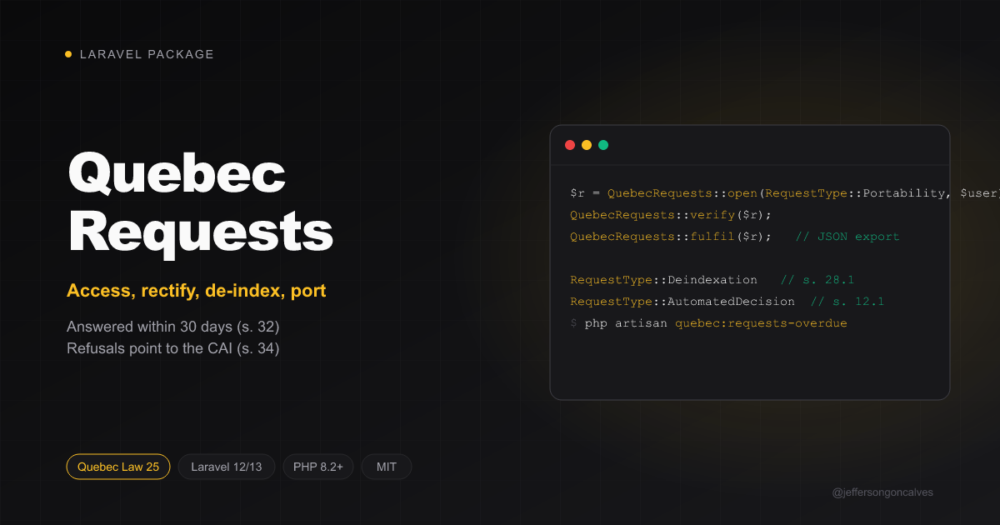

# Laravel Quebec Requests



[](https://packagist.org/packages/jeffersongoncalves/laravel-quebec-requests)
[](https://github.com/jeffersongoncalves/laravel-quebec-requests/actions/workflows/tests.yml)
[](https://packagist.org/packages/jeffersongoncalves/laravel-quebec-requests)

Handles requests under Quebec's private sector privacy act (Law 25), using the personal information you declared with [laravel-quebec](https://github.com/jeffersongoncalves/laravel-quebec):

- tracks each request: its type (access and portability, s. 27; rectification and deletion of outdated or unjustified information, s. 28; de-indexation or cessation of dissemination, s. 28.1; the information behind an automated decision, s. 12.1), its status and the legal deadline: 30 days, after which an unanswered request is deemed refused (s. 32);
- requires an **identity check** before any export or erasure;
- **exports** every piece of personal information of the person, from all your models, as JSON on a private disk (access, and portability in a structured, commonly used technological format);
- **deletes** the person's information by applying each column's strategy. Columns marked `Keep` are left untouched (information another law requires you to keep);
- fires an event for every request past its deadline, so you can alert the person in charge of the protection of personal information.

> This package gives you tooling. It does not make you compliant on its own. You still need legal review, for example to decide which requests you can reject and why.

## Installation

```bash
composer require jeffersongoncalves/laravel-quebec-requests
php artisan vendor:publish --tag="quebec-requests-migrations"
php artisan migrate
php artisan vendor:publish --tag="quebec-requests-config"
```

## Locating a person's information

Models listed in `quebec.models` (see [laravel-quebec](https://github.com/jeffersongoncalves/laravel-quebec)) are searched for the person's records:

- the subject's own model (e.g. `User`) is found without extra code;
- every other model says how to find the records that belong to a subject:

```php
use JeffersonGoncalves\QuebecRequests\Contracts\ResolvesPerson;

class Order extends Model implements HasPersonalData, ResolvesPerson
{
    use InteractsWithPersonalData;

    public static function personQuery(Model $subject): Builder
    {
        return static::query()->where('user_id', $subject->getKey());
    }
}
```

A model that does not implement `ResolvesPerson` is skipped.

## Usage

```php
use JeffersonGoncalves\QuebecRequests\Enums\RequestType;
use JeffersonGoncalves\QuebecRequests\Facades\QuebecRequests;

// 1. Open: from a logged-in user, or from a contact form (subject unknown yet)
$request = QuebecRequests::open(RequestType::Portability, $user);
$request = QuebecRequests::open(RequestType::Deletion, requester: ['name' => 'Mary', 'email' => 'mary@example.com']);

// 2. Verify the requester's identity, linking the subject if needed
QuebecRequests::verify($request, $user);

// 3a. Access / portability / deletion run automatically
QuebecRequests::fulfil($request, 'Your data is attached.');
$request->export_path; // quebec/requests/request-1.json on the configured disk

// 3b. Other rights (rectification, de-indexation, automated decisions): handle them yourself, then:
QuebecRequests::complete($request, 'Your address was corrected.');
QuebecRequests::reject($request, 'Refused under s. 39: ... You may apply to the Commission d\'accès à l\'information within 30 days.');
```

A refusal must give the reasons and the provision it rests on, and tell the person they may apply to the Commission d'accès à l'information (CAI) within 30 days (s. 34). The private sector act has no extension: `extend()` refuses unless you set `quebec-requests.extension`.

Lower-level helpers: `QuebecRequests::export($user)`, `QuebecRequests::exportToFile($user, 'file.json')`, `QuebecRequests::erase($user)`. `erase` runs inside a transaction.

### Events

| Event | When |
|---|---|
| `PrivacyRequestOpened` | a request is opened. Use it to confirm receipt to the requester |
| `PrivacyRequestClosed` | a request is completed or rejected. Use it to notify the requester, sending the export as needed |
| `PrivacyRequestOverdue` | `quebec:requests-overdue` found an open request past its 30 days: deemed refused (s. 32) |

Schedule the deadline check:

```php
Schedule::command('quebec:requests-overdue')->daily();
```

## Testing

```bash
composer test
```

## Changelog

See [CHANGELOG](CHANGELOG.md).

## License

The MIT License (MIT). See [License File](LICENSE.md).
